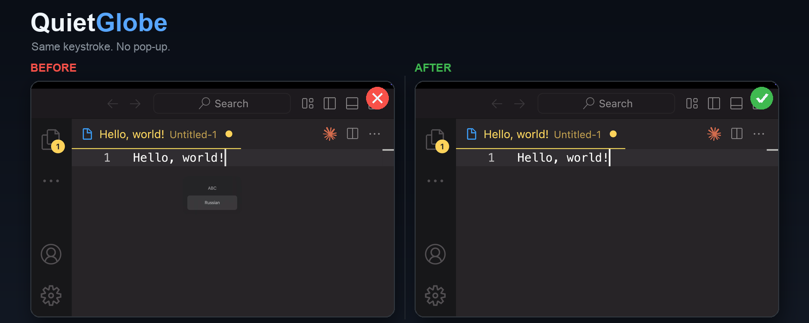
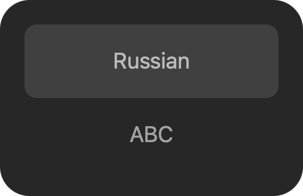
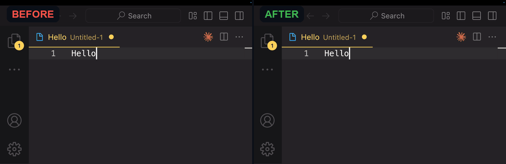

# QuietGlobe

**Disable the system-wide macOS input source indicator — the ABC/Russian popup — for any keyboard layout. Switch input sources instantly with the 🌐 Globe key: no popup, no HUD, no delay.**

**English** · [Русский](README.ru.md) · [Install](#install) · [FAQ](#faq)

[](https://www.apple.com/macos/)
[](https://swift.org)
[](LICENSE)
[](https://brew.sh)



## The problem

On macOS, when you press the 🌐 Globe (Fn) key to switch between keyboard layouts — **ABC ↔ Russian**, **ABC ↔ German**, or any other enabled pair — the system can show a floating **input source indicator** with the layout names. It is system-wide: the popup appears for any enabled keyboard layout, not only ABC/Russian.

It is not just cosmetic:

- it covers your text;
- it stays on screen until you type or it times out;
- it interrupts typing, presentations, screen recordings, and demos.

If you searched for **“disable ABC/Russian popup macOS”**, **“macOS input source indicator”**, **“Globe key HUD”**, **“language switcher popup”**, or **“hide input source HUD”**, this is the popup you mean.



## The fix

**QuietGlobe** intercepts the Globe key, switches the keyboard layout instantly with the public macOS Text Input Sources API, and suppresses the HUD. You keep the same key, but the switch is silent.

- Works with **every enabled keyboard layout** — ABC, Russian, German, French, and more.
- No popup. No delay.
- Native Swift, no private APIs, no network, no telemetry.
- Open source (MIT).



## Install

### Homebrew (recommended)

```bash
brew install Nishikinodzuki/tap/quietglobe
```

Or with an explicit tap:

```bash
brew tap Nishikinodzuki/tap
brew install quietglobe
```

> Homebrew 7+ detects casks automatically. On older versions, add `--cask` to the install command.

### Manual

Download the latest `QuietGlobe-*.zip` from [GitHub Releases](https://github.com/Nishikinodzuki/quietglobe/releases/latest), unzip it, and move `QuietGlobe.app` to `/Applications`.

## First launch

1. Open **QuietGlobe**.
2. macOS asks for **Accessibility** permission. QuietGlobe needs it to intercept the Globe key before the system HUD appears.
3. Open **System Settings → Privacy & Security → Accessibility** and enable **QuietGlobe**.
4. QuietGlobe detects the permission automatically and starts. No restart needed.

> Accessibility permission cannot be granted automatically by macOS. This is a system security requirement, not an installer limitation.

## Usage

- Press **🌐 (Globe/Fn)** to switch between your last used keyboard layouts.
- The Globe key must be configured as **“Change Input Source”** in **System Settings → Keyboard**.
- QuietGlobe lives in the menu bar. Click the 🌐 globe to:
  - **Enabled** — toggle Globe key interception.
  - **Launch at Login** — start QuietGlobe when you log in.
  - **Accessibility Settings…** — open the exact permission pane.
  - **Quit QuietGlobe**.

## Supported macOS

| macOS | Status |
|---|---|
| macOS 13 Ventura | Supported |
| macOS 14 Sonoma | Supported |
| macOS 15 Sequoia | Supported |
| macOS 26 / 27 | Supported (tested on 27.2) |

- Apple Silicon and Intel (Universal 2).
- The Globe key is available on Apple keyboards and most modern MacBook keyboards.

## FAQ

### How do I disable the ABC/Russian popup on macOS?

Install QuietGlobe, grant Accessibility permission, and keep the Globe key set to “Change Input Source”. QuietGlobe switches the layout itself and suppresses the macOS input source indicator. This works for every enabled keyboard layout, not only ABC/Russian. There is no supported macOS setting that removes this popup, which is why QuietGlobe exists.

### Why does macOS show the input source indicator?

macOS shows the indicator when the input source changes via the Globe key or a keyboard shortcut. It is meant to confirm the new layout, but it often stays on screen until you type, which interrupts typing and screen recordings.

### Does QuietGlobe work with Caps Lock or Ctrl+Space?

The first release targets the 🌐 Globe key. Caps Lock and custom shortcuts are on the roadmap. You can still switch layouts with any method — QuietGlobe only removes the popup for the Globe key.

### Why does QuietGlobe need Accessibility permission?

To intercept the Globe key before the system HUD appears, QuietGlobe uses a macOS event tap. macOS requires Accessibility permission for global keyboard event taps. QuietGlobe does not read, store, or send your keystrokes.

### Is QuietGlobe free?

Yes. QuietGlobe is free and open source under the MIT license. There are no ads, subscriptions, or analytics.

### Does QuietGlobe collect data?

No. QuietGlobe has no network access, no telemetry, and no analytics. The source code is public.

### How do I uninstall QuietGlobe?

Quit QuietGlobe, remove it from `/Applications`, and disable/remove it in **System Settings → Privacy & Security → Accessibility**. If you used Homebrew: `brew uninstall --cask quietglobe`.

### Does QuietGlobe work on macOS 13, 14, 15, 26, and 27?

Yes, QuietGlobe targets macOS 13 Ventura and later. It is built as a Universal 2 binary for Apple Silicon and Intel Macs.

## How it works

1. QuietGlobe registers a global event tap for the Globe key.
2. When you press 🌐, it consumes the key event before the system can show the HUD.
3. It reads the enabled keyboard layouts with `TISCreateInputSourceList`.
4. It switches to the next layout with `TISSelectInputSource`.
5. The result is an instant layout switch with no input source indicator.

QuietGlobe uses public macOS APIs: `CoreGraphics` event taps and the Carbon Text Input Sources API. No private frameworks, no kernel extensions, no keystroke logging.

## Privacy

- No network requests.
- No analytics or telemetry.
- No keystroke content is stored or transmitted.
- The source is open for review.

## Build from source

Requirements: macOS 13+, Xcode Command Line Tools.

```bash
git clone https://github.com/Nishikinodzuki/quietglobe.git
cd quietglobe
./scripts/build.sh
open QuietGlobe.app
```

## Contributing

Issues and pull requests are welcome. See [CONTRIBUTING.md](CONTRIBUTING.md). If QuietGlobe helped you, star the repo — it helps other people find it.

## License

MIT © Nishikinodzuki. See [LICENSE](LICENSE).
