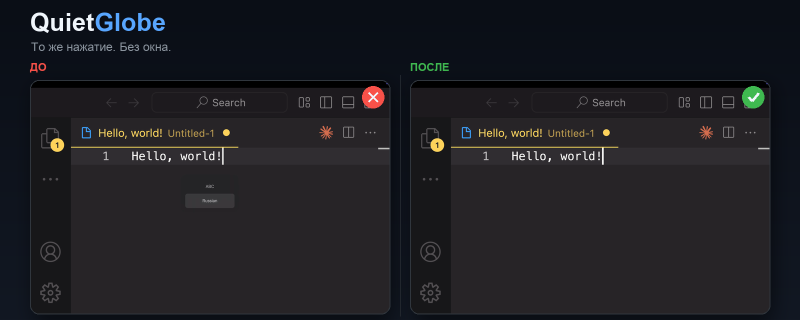
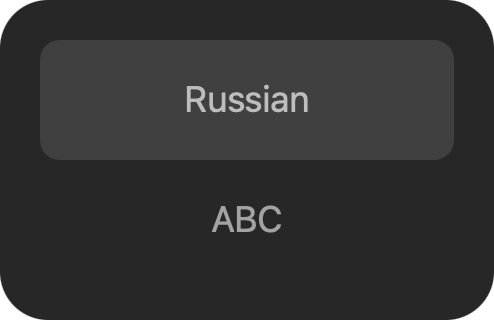
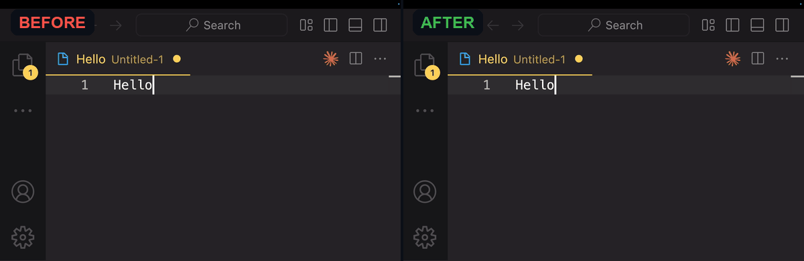

# QuietGlobe

**Убирает системный индикатор источника ввода macOS — окно ABC/Russian — для любой раскладки. Переключение по клавише 🌐 мгновенное: без окна, без HUD, без задержки.**

[English](README.md) · **Русский** · [Установка](#установка) · [Обратная связь](#обратная-связь) · [FAQ](#faq)

[](https://www.apple.com/macos/)
[](https://swift.org)
[](LICENSE)
[](https://brew.sh)



## Проблема

На macOS при нажатии 🌐 (Globe/Fn) для смены раскладки — **ABC ↔ Russian**, **ABC ↔ German** или любой другой включённой пары — по центру экрана появляется всплывающий **индикатор источника ввода** с названиями раскладок. Он системный: окно появляется для любой включённой раскладки, а не только ABC/Russian.

Это не просто косметика:

- окно перекрывает текст;
- висит на экране, пока не начнёшь печатать или пока не истечёт таймер;
- мешает печати, презентациям, записи экрана и демо.

Если вы искали **«убрать окно ABC/Russian на macOS»**, **«индикатор раскладки macOS»**, **«всплывающее окно при смене языка»**, **«Globe key HUD»** или **«переключение раскладки без окна»** — это именно оно.



## Решение

**QuietGlobe** перехватывает клавишу 🌐, мгновенно переключает раскладку через публичный API macOS Text Input Sources и подавляет HUD. Клавиша остаётся той же, но переключение становится тихим.

- Работает с **любой включённой раскладкой** — ABC, Russian, German, French и другими.
- Никакого окна. Никакой задержки.
- Нативный Swift, без приватных API, без сети и телеметрии.
- Открытый исходный код (MIT).



## Установка

### Homebrew (рекомендуется)

```bash
brew install Nishikinodzuki/tap/quietglobe
```

Или с явным tap:

```bash
brew tap Nishikinodzuki/tap
brew install quietglobe
```

> В Homebrew 7+ cask определяется автоматически. В более старых версиях добавьте `--cask` к команде установки.

После установки откройте **QuietGlobe** из `/Applications` — приложение работает в менюбаре (без иконки в Dock).

### Если macOS просит доступ к связке ключей

Это Git (`git-credential-osxkeychain`), а не QuietGlobe. Используйте установщик без окна:

```bash
curl -fsSL https://raw.githubusercontent.com/Nishikinodzuki/quietglobe/main/scripts/brew-install.sh | bash
```

Он отключает Git credential helper для клонирования tap и пропускает auto-update. Или нажмите **«Отказать»** и используйте ручную установку ниже.

### Вручную

Скачайте последний `QuietGlobe-*.zip` со страницы [GitHub Releases](https://github.com/Nishikinodzuki/quietglobe/releases/latest), распакуйте и перенесите `QuietGlobe.app` в `/Applications`.

## Первый запуск

1. Откройте **QuietGlobe**.
2. macOS попросит разрешение **Accessibility**. Оно нужно, чтобы перехватить 🌐 до того, как система покажет HUD.
3. Откройте **System Settings → Privacy & Security → Accessibility** и включите **QuietGlobe**.
4. QuietGlobe сам заметит разрешение и запустится. Перезапуск не нужен.

> macOS не позволяет выдать Accessibility автоматически. Это системное требование безопасности, а не ограничение установщика.

## Использование

- Нажимайте **🌐 (Globe/Fn)**, чтобы переключаться между последними раскладками.
- Клавиша 🌐 должна быть настроена как **«Change Input Source»** в **System Settings → Keyboard**.
- QuietGlobe живёт в менюбаре. Клик по глобусу:
  - **Enabled** — включить/выключить перехват 🌐;
  - **Launch at Login** — автозапуск при входе;
  - **Accessibility Settings…** — открыть нужную панель разрешений;
  - **Quit QuietGlobe**.

## Поддерживаемые версии macOS

| macOS | Статус |
|---|---|
| macOS 13 Ventura | Поддерживается |
| macOS 14 Sonoma | Поддерживается |
| macOS 15 Sequoia | Поддерживается |
| macOS 26 / 27 | Поддерживается (проверено на 27.2) |

- Apple Silicon и Intel (Universal 2).
- Клавиша 🌐 есть на клавиатурах Apple и большинстве современных MacBook.

## FAQ

### Как убрать окно ABC/Russian на macOS?

Установите QuietGlobe, выдайте разрешение Accessibility и оставьте 🌐 в режиме «Change Input Source». QuietGlobe сам переключает раскладку и подавляет индикатор. Это работает для любой включённой раскладки, а не только ABC/Russian. Штатной настройки macOS, которая убирает это окно, нет — поэтому и существует QuietGlobe.

### Почему macOS показывает индикатор источника ввода?

macOS показывает его при смене раскладки по 🌐 или горячей клавише. Он должен подтверждать новую раскладку, но часто висит на экране до начала печати и мешает.

### QuietGlobe работает с Caps Lock или Ctrl+Space?

Первый релиз рассчитан на клавишу 🌐. Caps Lock и произвольные сочетания — в дорожной карте. Переключать раскладку можно любым способом, но QuietGlobe убирает окно именно для 🌐.

### Зачем QuietGlobe разрешение Accessibility?

Чтобы перехватить 🌐 до появления системного HUD, QuietGlobe использует event tap macOS. Для глобального перехвата клавиш macOS требует Accessibility. QuietGlobe не читает, не хранит и не отправляет нажатия.

### QuietGlobe бесплатный?

Да. QuietGlobe бесплатный и открытый, под лицензией MIT. Без рекламы, подписок и аналитики.

### QuietGlobe собирает данные?

Нет. Нет сетевых запросов, телеметрии и аналитики. Исходный код открыт.

### Как удалить QuietGlobe?

Завершите QuietGlobe, удалите его из `/Applications` и отключите/удалите в **System Settings → Privacy & Security → Accessibility**. Если ставили через Homebrew: `brew uninstall --cask quietglobe`.

### QuietGlobe работает на macOS 13, 14, 15, 26 и 27?

Да, QuietGlobe рассчитан на macOS 13 Ventura и новее. Собирается как Universal 2 для Apple Silicon и Intel.

## Как это работает

1. QuietGlobe ставит глобальный event tap на клавишу 🌐.
2. При нажатии 🌐 он забирает событие до того, как система покажет HUD.
3. Читает включённые раскладки через `TISCreateInputSourceList`.
4. Переключает на следующую через `TISSelectInputSource`.
5. В результате — мгновенная смена раскладки без индикатора.

Используются публичные API macOS: event tap из `CoreGraphics` и Carbon Text Input Sources. Без приватных фреймворков, кернел-расширений и логирования нажатий.

## Приватность

- Нет сетевых запросов.
- Нет аналитики и телеметрии.
- Содержимое нажатий не сохраняется и не передаётся.
- Исходный код открыт для проверки.

## Сборка из исходников

Требования: macOS 13+, Xcode Command Line Tools.

```bash
git clone https://github.com/Nishikinodzuki/quietglobe.git
cd quietglobe
./scripts/build.sh
open QuietGlobe.app
```

## Обратная связь

- **Баги и конкретные фичреквесты:** [GitHub Issues](https://github.com/Nishikinodzuki/quietglobe/issues)
- **Идеи и предложения:** [GitHub Discussions → Ideas](https://github.com/Nishikinodzuki/quietglobe/discussions/categories/ideas)
- **Вопросы:** [GitHub Discussions → Q&A](https://github.com/Nishikinodzuki/quietglobe/discussions/categories/q-a)
- **Уязвимости:** приватно через [SECURITY.md](SECURITY.md).

## Участие

Pull requests приветствуются. См. [CONTRIBUTING.md](CONTRIBUTING.md). Если QuietGlobe помог — поставьте звезду, это помогает другим найти проект.

## Лицензия

MIT © Nishikinodzuki. См. [LICENSE](LICENSE).
